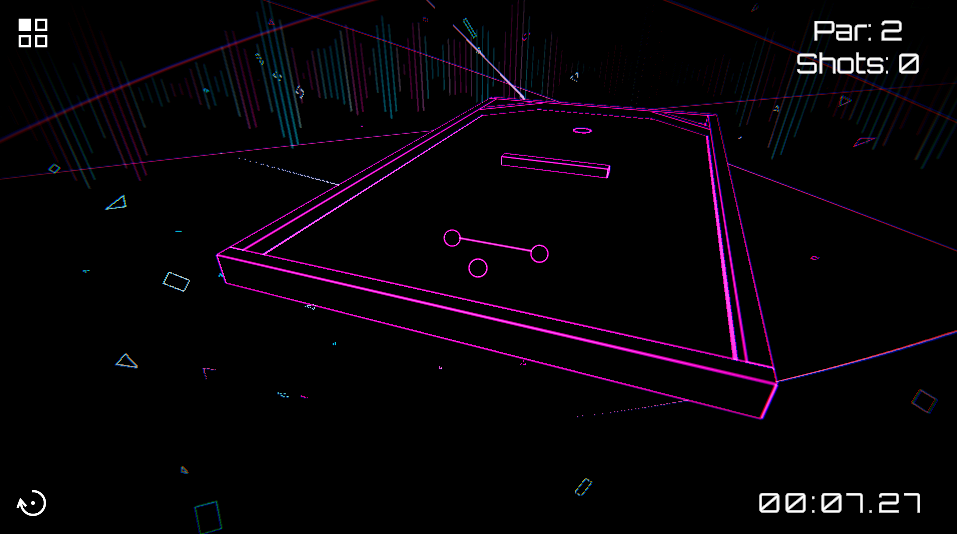

# CRACK-SHOT

**2つの球の間をすり抜けて、ホールを狙え。** 
ゲートを通してからカップインする、ひと味ちがうミニゴルフパズル。

 

  

**[▶ unityroom でプレイする](https://unityroom.com/games/crack-shot)**

 

## 遊び方

フィールドには 3 つの球があります。そのうち 1 つを打ち、残り 2 つの球を結ぶライン **GATE** をくぐらせましょう。
GATE をくぐったうえでホールに入れれば、ステージクリアです。

| 判定 | 条件 |
| --- | --- |
| **CLEAR** | GATEを通過してからホールイン |
| **SUCCESS** | GATEを通過した（続けて次のショットへ） |
| **MISS** | GATEを通過しなかった／ほかの球に当たった／場外に出た／GATEを通らずにホールインした |

MISS になると、球は打つ前の位置に戻ります。少ない打数・短いタイムでのクリアを目指しましょう。

プレイ動画は [Video.mp4](Video.mp4) にあります。

## 操作方法

| 操作 | 入力 |
| --- | --- |
| ショット | 左ドラッグで引っぱって離す（球の近くで離すとキャンセル） |
| 打つ球の切り替え | `←` `→` ／ `A` `D` |
| カメラ回転 | 右ドラッグ |
| ズーム | マウスホイール |
| 真上からの視点 | `↑` ／ `W` |
| 視点リセット | `↓` ／ `S` |

## 特徴

- **全 4 ステージ** — 球の配置とコースを読み解くパズル
- **ベスト記録** — ステージごとに最少打数・最短タイムを保存
- **オンラインランキング** — 一部のステージは unityroom のランキングに対応
- **設定** — 音量やカメラ感度を調整できます

## 開発

- Unity 2022.3.61f1
- Universal Render Pipeline 14.0.12
- TextMesh Pro
- [unityroom-client-library](https://github.com/naichilab/unityroom-client-library)（ランキング送信）

Unity Hub からこのフォルダを開けば動きます。シーンは `Assets/Project/Scenes/` にあり、Title → Select → Play → Result の順に進みます。

クローンしたプロジェクトを開くときは、次の 2 点に注意してください。

- 音素材はリポジトリに含めていないので、そのままだと BGM・効果音が鳴りません。`Assets/Project/Audio/` に自分で用意してください。
- ランキング送信用の HMAC キー（`Assets/Project/Resources/HmacKey.txt`）も含めていません。なくてもゲームは動き、ランキングに送信されないだけです。

## クレジット

- **BGM**：[踊る、宇宙の中で](https://dova-s.jp/bgm/detail/15926)（DOVA-SYNDROME）
- **フォント**：[Orbitron](https://fonts.google.com/specimen/Orbitron)（Google Fonts / SIL Open Font License）

## ライセンス

ソースコードは [MIT License](LICENSE) で公開しています。© 2026 Mimish

- BGM・効果音などの音素材は、ライセンス上の理由からリポジトリに含めていません。
- 同梱のフォント Orbitron には SIL Open Font License が適用されます。
